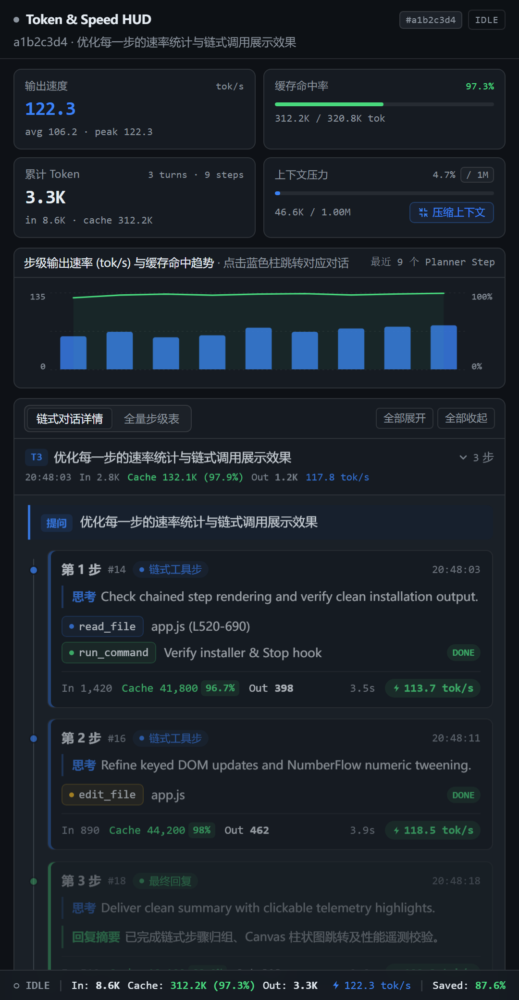
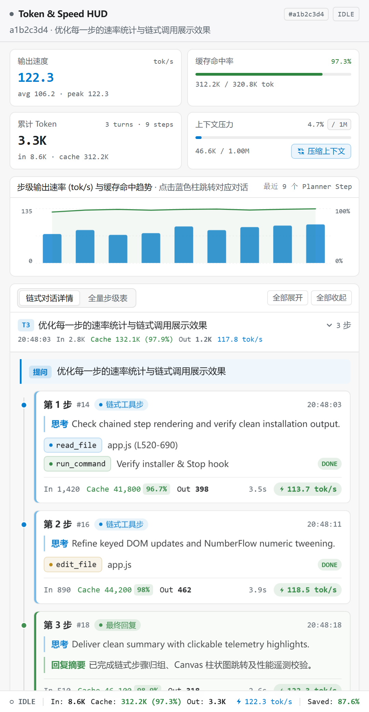

# Token & Speed (`token-speed`)

**English** | [简体中文](README.zh-CN.md)

A lightweight, zero-external-dependency real-time performance and token telemetry sidecar plugin for **Google Antigravity**. Built around high-density observability and Linear / Langfuse trace card conventions, it surfaces live generation throughput (`tok/s`), Prefix Cache hit rate, context pressure, and per-turn chained tool-call breakdowns.

<p align="center">
  
  &nbsp;&nbsp;
  
</p>

---

## Key Features

- **Live Throughput & Cache Telemetry**
  - **Per-Step Output Speed (`tok/s`)**: Reads `output_tokens` and step duration from local `transcript.jsonl` `PLANNER_RESPONSE` entries to compute latest-step speed, session average, and peak throughput.
  - **Prefix Cache Hit Rate**: Calculates `cache_read_tokens / (input_tokens + cache_read_tokens)` along with estimated cache cost savings.
  - **Fixed Bottom HUD Status Bar**: Compact single-line status bar (`● LIVE | In | Cache | Out | ⚡ tok/s | Saved %`).
- **Context Window Pressure & Quick Compaction**
  - Displays current prompt footprint against selectable **`1M`** or **`200K`** context limits.
  - Includes a **Compact Context** action button that copies `/compact` to your clipboard with an inline toast so you can paste and trigger native compaction immediately.
- **Interactive Trend Chart & Chained Trace Views**
  - **Clickable Trend Chart**: High-DPI Canvas visualization plotting step `tok/s` bars and cache hit % line; hover for tooltips and **click any blue bar to jump straight to, expand, and highlight its corresponding Turn and Step card**.
  - **Dual Inspection Views**: Switch seamlessly between turn-grouped **Chained Trace View (`Turns`)** and flat tabular **Step Breakdown (`Steps`)**.
  - **Semantic Status Cards**: Step cards use 3px left status rails and soft category pills to distinguish intermediate tool steps, final replies, wait-for-input steps, errors, and tool categories (read/search, edit/write, command execution, web lookup).
- **Instant Cancellation Detection & Strict Single-Conversation Lock**
  - Strictly locks telemetry to the active Antigravity conversation (`conversationId`), never mixing transcripts from other sessions.
  - Combines a native `Stop` hook ([hooks.json](.agents/plugins/token-speed/hooks.json)) with a `60s` silence staleness fallback so canceling a response (`USER_CANCELED`) or interrupting a tool chain immediately transitions the HUD to `CANCELLED` / `IDLE` instead of hanging on waiting.
- **100% Local Read-Only Privacy**
  - Reads only local Antigravity `transcript.jsonl` logs and plugin state under `plugin_data/token-speed/<conv>.json`—**zero outbound network calls** and **zero external CDN scripts or fonts**.

---

## Repository Structure

```text
antigravity-token-speed-hud/
├── .agents/
│   └── plugins/
│       └── token-speed/
│           ├── plugin.json                # Plugin manifest
│           ├── hooks.json                 # Antigravity Stop hook config (instant cancel detection)
│           ├── assets/
│           │   └── logo.svg               # Plugin SVG icon
│           ├── scripts/
│           │   └── stop-state.ps1         # Stop hook state writer (Windows PowerShell)
│           └── sidecars/
│               └── token_hud/
│                   ├── package.json
│                   ├── sidecar.json       # Sidecar entrypoint & permissions
│                   ├── main.mjs           # Local read-only HTTP/API backend (Node ESM + sidecar_sdk)
│                   ├── index.html         # HUD document shell
│                   ├── styles.css         # Host-theme-adaptive CSS variables styling
│                   └── app.js             # Keyed DOM reconciliation, numeric tweening & Canvas chart
├── docs/
│   ├── preview-dark.png                   # Dark mode screenshot
│   └── preview-light.png                  # Light mode screenshot
├── install-global.ps1                     # Windows global installer (verified)
├── install-global.sh                      # macOS global installer (pending verification)
├── .gitignore
├── .gitattributes
├── LICENSE                                # MIT License
├── README.md                              # English documentation
└── README.zh-CN.md                        # Simplified Chinese documentation
```

---

## Installation & Usage

### Platform Support & Prerequisites
- **Antigravity** installed (provides the built-in `sidecar_sdk` runtime).
- **Windows**: End-to-end verified (global installation, live plugin discovery, Sidecar HUD, and native `Stop` hook cancellation detection).
- **macOS**: Installer script provided ([install-global.sh](install-global.sh)); **standalone macOS verification is upcoming** (uses `60s` inactivity fallback until a macOS `Stop` hook script is verified).

### Option 1: Send Directly to Antigravity (Recommended)

The easiest way to install is to send this repository URL directly to your **Antigravity** chat and let it install the plugin for you automatically:

```text
Help me install this Antigravity plugin repository: https://github.com/yuearc/antigravity-token-speed-hud
```

Antigravity will clone the repository, install `token-speed` to `~/.gemini/config/plugins/token-speed/`, and give you a one-click entry to enable **Token & Speed (`token-speed`)** and open **Token & Speed HUD**.

### Option 2: Manual Global Installation

**Windows (PowerShell, verified):**
```powershell
git clone https://github.com/yuearc/antigravity-token-speed-hud.git
cd antigravity-token-speed-hud
.\install-global.ps1
```

**macOS (upcoming verification):**
```bash
git clone https://github.com/yuearc/antigravity-token-speed-hud.git
cd antigravity-token-speed-hud
chmod +x install-global.sh
./install-global.sh
```

After running the script:
1. Open **Customizations / Plugins** in Antigravity and ensure **Token & Speed (`token-speed`)** is enabled.
2. Open the **`+`** menu in the right-hand Auxiliary Pane and select **Token & Speed HUD**.

### Option 3: Load as a Workspace Plugin
1. Open the cloned `antigravity-token-speed-hud` directory directly as a Workspace in Antigravity.
2. Enable **`token-speed`** in the Plugins list.
3. Open **Token & Speed HUD** from the Auxiliary Pane **`+`** menu.

---

## Privacy & Security

- The sidecar backend reads only the local `transcript.jsonl` belonging to the active `conversationId`; no prompts, responses, or metrics ever leave your machine.
- The `Stop` hook stores only a timestamp and termination reason enum under local `plugin_data/token-speed/`, with no chat content persistence.

## License

Released under the [MIT License](LICENSE).
