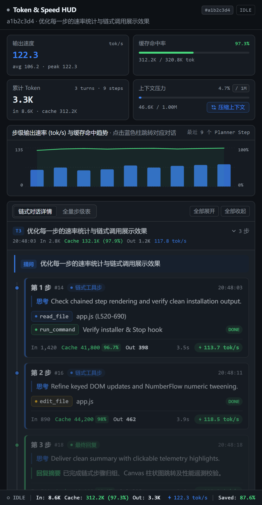
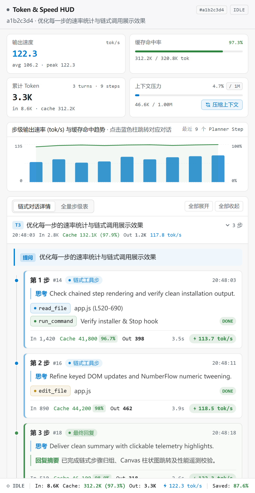

# Antigravity Telemetry HUD (`telemetry-hud`)

[English](README.md) | **简体中文**

一个为 **Google Antigravity** 打造的轻量级、零外部依赖实时性能与 Token 遥测 Sidecar 插件。基于高密度追踪面板与 Linear / Langfuse 卡片规范设计，实时展示当前会话的生成速率（`tok/s`）、Prefix Cache 命中率、上下文压力、以及按每句对话归组的链式工具调用详情。

<p align="center">
  
  &nbsp;&nbsp;
  
</p>

---

## 核心特性

- **实时吞吐与缓存遥测**
  - **步级输出速率 (`tok/s`)**：读取本地 `transcript.jsonl` 中每个 `PLANNER_RESPONSE` 的 `output_tokens` 与步骤耗时，实时计算最新步速度、会话均值与峰值。
  - **Prefix Cache 命中率**：统计 `cache_read_tokens / (input_tokens + cache_read_tokens)`，并估算缓存成本节省比例。
  - **固定底部 HUD 状态栏**：单行紧凑状态条（`● LIVE | In | Cache | Out | ⚡ tok/s | Saved %`）。
- **上下文窗口压力监控与快速压缩**
  - 实时展示当前 Prompt 占用比例，支持在 **`1M`** 与 **`200K`** 上限之间一键切换。
  - 提供「压缩上下文 / 建议压缩」按钮，点击即可复制 `/compact` 指令并提示在输入框粘贴回车执行压缩。
- **交互式趋势图与链式追踪视图**
  - **可点击趋势柱状图**：高 DPI Canvas 绘制每步 `tok/s`（柱）与 Cache Hit %（折线），悬停显示详情，**点击蓝色柱直接展开并滚动高亮对应的对话 Turn 与 Step 卡片**。
  - **双视图切换**：支持按每条用户提问归纳的多步 **链式调用视图（Turns）** 与 **步级表格视图（Steps）**。
  - **语义化状态卡片**：卡片采用 3px 左侧状态锚条 + 分类语义徽章区分 `链式工具步` / `最终回复` / `等待确认` / `执行异常`，并细分读/检索、写/编辑、命令执行、联网检索工具类型。
- **取消响应即时感知与严格单会话锁定**
  - 严格锁定当前打开的 Antigravity 对话（仅读取所属 `conversationId` 轨迹，不混读其他会话）。
  - 通过原生 `Stop` Hook（[hooks.json](.agents/plugins/telemetry-hud/hooks.json)）+ `60s` 静默超时兜底，在用户取消回答（`USER_CANCELED`）或中断工具链后立即切换为 `CANCELLED` / `IDLE`，不会永久卡在「等待模型响应…」。
- **100% 本地只读，零外传**
  - 仅在本地读取 Antigravity 的 `transcript.jsonl` 与插件自身 `plugin_data/telemetry-hud/<conv>.json`，**不发起任何外网请求**、**不引入第三方 CDN 脚本/字体**。

---

## 目录结构

```text
antigravity-telemetry-hud/
├── .agents/
│   └── plugins/
│       └── telemetry-hud/
│           ├── plugin.json                # 插件清单
│           ├── hooks.json                 # Antigravity Stop Hook 配置（即时捕获取消）
│           ├── assets/
│           │   └── logo.svg               # 插件图标
│           ├── scripts/
│           │   └── stop-state.ps1         # Stop Hook 状态记录脚本（Windows PowerShell）
│           └── sidecars/
│               └── token_hud/
│                   ├── package.json
│                   ├── sidecar.json       # Sidecar 入口与权限声明
│                   ├── main.mjs           # 本地只读 HTTP/API 后端（Node ESM + sidecar_sdk）
│                   ├── index.html         # HUD 页面骨架
│                   ├── styles.css         # 主题自适应（Host CSS Variables）样式
│                   └── app.js             # Keyed DOM 同步、数字缓动与 Canvas 图表
├── docs/
│   ├── preview-dark.png                   # 深色模式效果截图
│   └── preview-light.png                  # 浅色模式效果截图
├── install-global.ps1                     # Windows 全局安装脚本（已验证）
├── install-global.sh                      # macOS 全局安装脚本（待后续验证）
├── .gitignore
├── .gitattributes
├── LICENSE                                # MIT License
├── README.md                              # 英文 README
└── README.zh-CN.md                        # 简体中文 README
```

---

## 安装与使用

### 平台支持与前置条件
- 已安装 **Antigravity**（内置 `sidecar_sdk` 运行时）。
- **Windows**：已完整验证可用（全局安装脚本、插件识别、`Stop` Hook 取消检测均已实测通过）。
- **macOS**：已提供安装脚本（[install-global.sh](install-global.sh)），**待后续在 macOS 环境单独验证**（验证完成前默认依赖 60 秒静默超时兜底）。

### 方式 1：直接发给你的 Antigravity 安装（最推荐）

不用手动折腾命令行——**直接把这个 GitHub 仓库地址发给你的 Antigravity**，让它自动帮你完成克隆与安装即可：

```text
帮我安装这个 Antigravity 插件仓库：https://github.com/yuearc/antigravity-telemetry-hud
```

Antigravity 会自动拉取仓库并安装到 `~/.gemini/config/plugins/telemetry-hud/`，随后给出启用入口与侧边栏面板入口，点击启用 **Antigravity Telemetry HUD (`telemetry-hud`)** 即可使用。

### 方式 2：手动运行脚本全局安装（所有项目可用）

**Windows (PowerShell，已验证):**
```powershell
git clone https://github.com/yuearc/antigravity-telemetry-hud.git
cd antigravity-telemetry-hud
.\install-global.ps1
```

**macOS（待后续验证）:**
```bash
git clone https://github.com/yuearc/antigravity-telemetry-hud.git
cd antigravity-telemetry-hud
chmod +x install-global.sh
./install-global.sh
```

安装完成后：
1. 在 Antigravity 中打开 **Customizations / Plugins** 页面，确认 **Antigravity Telemetry HUD (`telemetry-hud`)** 已开启。
2. 点击右侧辅助面板（Auxiliary Pane）右上角 **`+`** 菜单，选择 **Token & Speed HUD**。

### 方式 3：作为单工作区插件试用
1. 在 Antigravity 中直接将克隆下来的 `antigravity-telemetry-hud` 目录打开为当前工作区（Workspace）。
2. 在插件列表中启用 **`telemetry-hud`**。
3. 从右侧辅助面板 **`+`** 菜单打开 **Token & Speed HUD**。

---

## 隐私与安全说明

- 本插件后台仅读取当前 `conversationId` 对应的本地 `transcript.jsonl`，不上传任何对话文本或指标。
- `Stop` Hook 脚本仅在本机 `plugin_data/telemetry-hud/` 下写入当前会话的停止时间戳与终止原因枚举，无任何持久化聊天正文行为。

## 开源协议

基于 [MIT License](LICENSE) 开源。
